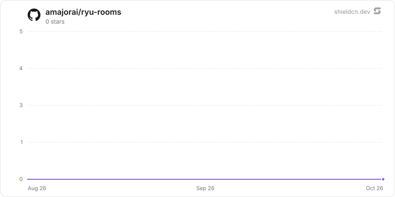

<div align="center">

# rooms

</div>

Shared model rooms hosted by the active Ryu node: QR invites, synchronized transcripts, and governed Mesh LLM inference across devices.

> **The public home of `ryu-rooms`.** Source, builds, and releases live here —
> binaries for every platform are attached to each release.
>
> This tree is generated from the Ryu monorepo, so commits pushed here
> directly are replaced on the next sync. **Pull requests are welcome** —
> open them here and they are ported into the monorepo, then flow back out.
> Ryu as a whole: https://github.com/amajorai/ryu

## Install

**App:** [Install](ryu://apps/com.ryu.rooms) (opens the Ryu desktop app and asks you to confirm)

**CLI:**

```bash
ryu apps add com.ryu.rooms
```

**From source:**

```bash
cargo build --release --manifest-path backend/Cargo.toml
```

Prebuilt binaries for every platform are attached to [each release](https://github.com/amajorai/ryu/releases).

## License

Apache-2.0 — see [LICENSE](./LICENSE).

## Build

Build the companion first so the sidecar embeds the generated guest carriage, then
run the sidecar checks:

```sh
bun run --cwd apps-store/rooms/ui build
cargo test --manifest-path apps-store/rooms/backend/Cargo.toml
cargo build --manifest-path apps-store/rooms/backend/Cargo.toml --bin ryu-rooms
```

The protected host API is mounted at `/api/rooms`; the public guest carriage and
session endpoints use `/api/rooms/guest`. The guest exchange sets the app-owned
HttpOnly `ryu_rooms_session` cookie. The manifest explicitly allows only that
cookie through Core's public mount; Core authentication cookies stay in Core.
The sidecar binds to loopback and accepts only Core-issued ext-proxy requests.

## At rest

`rooms.db` seals the transcript per value (`encb:v1:`, store `rooms.db`, each value bound to its
table, column and row id) under the `@ryu/rooms` plugin subkey Core delivers to the sidecar
(`crypto:seal` in the sidecar's `host_api.grants`): `room_messages.text`,
`room_runs.input_text`, `room_runs.partial_text`, `room_runs.error_message` and
`room_participants.display_name`. The streamed partial answer is opened, extended and sealed
again on every delta; the idempotent-turn check compares opened text. Room ids, statuses,
timestamps, model ids, share origins and invite/session digests stay plaintext. Legacy plaintext
rows are sealed when the store opens (resumable, idempotent), then the WAL is truncated and freed
pages are zeroed (`secure_delete` is on for every connection). A message, participant or run
that does not open is skipped and counted (`/health` `sealing.unreadable_rows`); a room never
becomes unavailable because of one row. Key states (`backend/src/seal_keys.rs`):

- **Compat mode**: under an older Core that delivers no key, a never-sealed store keeps working
  in plaintext and `/health` reports `sealing.state = "compat"` ("waiting for a Ryu update").
- **No key or another key for a sealed store**: `sealing.state = "unhealthy"`, writes are
  refused and the data is kept; start-up recovery of interrupted runs still succeeds (it then
  clears the run's message and keeps `error_code = "nodeRestarted"`).
- **Standalone** (no `RYU_PLUGIN_DATA_DIR`): `RYU_MASTER_KEY` if set, else a generated root in
  `<plugin data dir>/secrets/standalone-root.key` (0600) whose key check value is pinned.

The standalone satellite mirror builds `ryu-crypto` from crates.io at the declared version, so
the release train that ships this must publish `ryu-crypto` first (already ordered before app
backends in `tools/publish-crates.sh`).

## Star History

<a href="https://github.com/amajorai/ryu-rooms/stargazers">
  <picture>
    <source media="(prefers-color-scheme: dark)" srcset="./.github/shieldcn/star-chart-dark.svg" />
    
  </picture>
</a>
